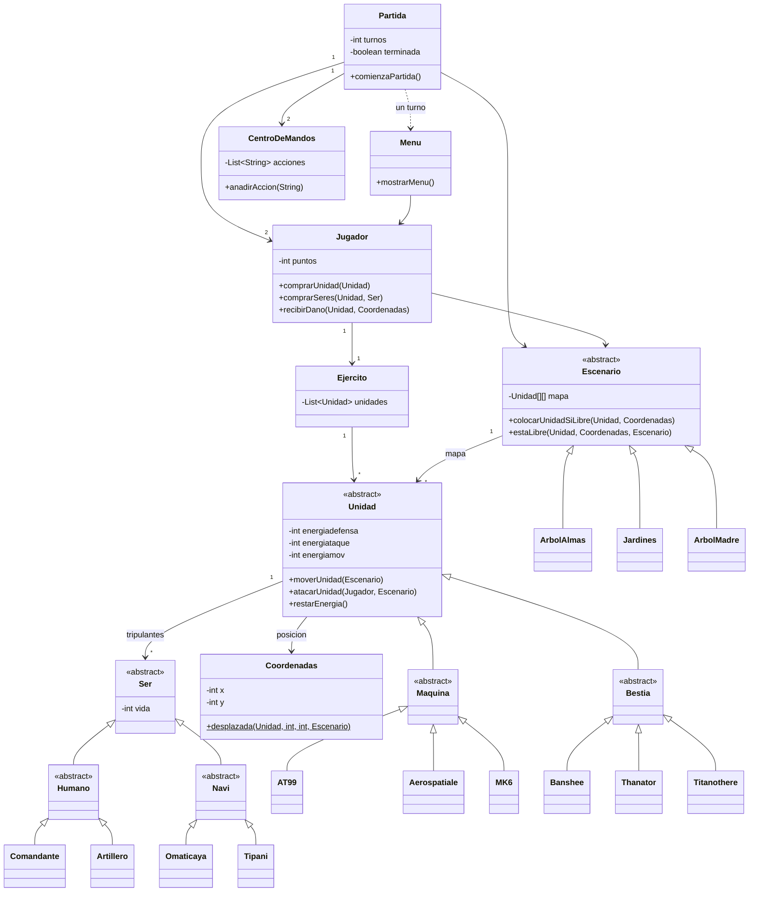

**English** · [Español](README.md)

# Avatar: Battle for Freedom

[](https://github.com/ArturoFierroPardo/avatar-battle-for-freedom/actions/workflows/build.yml)
[](https://openjdk.org/projects/jdk/17/)
[](LICENSE)
[](https://arturofierropardo.github.io/avatar-battle-for-freedom/)

A two-player, turn-based strategy game played on the console, set on Pandora.
Each player commands a faction — the human **RDA** or the **Na'vi** — buys
units, crews them, deploys them on a grid and fights until one army is wiped
out.

Written in Java as a coursework project for the Object-Oriented Programming
module of the Telecommunication Systems Engineering degree at Universidad CEU
San Pablo. The original submission is preserved in this repository's history;
the current version adds a Maven build, a test suite and fixes for the defects
that the review turned up.

> The game's interface is in Spanish, and so are the code identifiers and the
> Javadoc.

---

## Contents

- [How it plays](#how-it-plays)
- [Units and crew](#units-and-crew)
- [Battlegrounds](#battlegrounds)
- [Running it](#running-it)
- [Design](#design)
- [Project layout](#project-layout)
- [Tests](#tests)
- [License](#license)

---

## How it plays

Players alternate turns. On your turn you pick one action from the menu:

| Option | Action |
|---|---|
| 1 | Buy units, and the crew each one needs to operate |
| 2 | Move a unit |
| 3 | Attack an enemy unit |
| 4 | Open your command centre |
| 5 | Pass, ending your turn without acting |
| 6 | Save the game and quit |

One action per turn: buying, moving or attacking ends it, and option 5 is there
for when you would rather pass.

Everything costs **points**. You start with an allowance that depends on the
battleground, you spend it on units and crew, and you earn more by destroying
enemy units and killing their crew. A unit without its full crew can neither
move nor attack.

Combat resolves against a unit's **defence energy** first. Once that is gone,
the surplus damage is split evenly among the crew; crew members who run out of
life die, and a unit that loses its whole crew is destroyed and removed from
the board. Friendly fire is possible, and the command centre log says so when
it happens.

Moving and attacking also burn **movement energy** and **attack energy**, which
do not regenerate — so a unit has a finite useful life regardless of how much
damage it takes.

The **command centre** is each player's private log: every action by either
side is recorded with a timestamp, but you see more detail about your own moves
than about your opponent's — you are told that the enemy moved a unit, not
where it went.

Games can be saved and resumed; several saved games live side by side in
`partidas.dat` and are offered as a list on startup.

### A session, abbreviated

```
	AVATAR BATTLE FOR FREEDOM

-------------------ESCENARIOS-------------------

1) Arbol de las Almas:
	Nombre: Arbol de las Almas
	Puntos iniciales de cada jugador: 5000
	Dimension: 100X100
...
Jugador 1, elija su nombre:
Jugador 2, elija su nombre:

-------------------SELECCION DE EQUIPO-------------------

	1) Equipo RDA
	2) Equipo NAVI

La partida comienza en el escenario Arbol de las Almas.
Luchara Arturo del equipo NAVI contra Quaritch del equipo RDA

TURNO---------->  1
Turno de Arturo

-------------------MENU-------------------

	1) Comprar una unidad
	2) Mover una unidad
	3) Atacar a una unidad enemiga
	4) Ver el centro de mandos
	5) Finalizar el turno
	6) Finalizar y guardar partida
```

---

## Units and crew

Each faction has its own roster. Machines are crewed by humans, beasts are
ridden by Na'vi.

### RDA — machines

| Unit | Cost | Defence | Attack | Power | Range | Move | Crew |
|---|---|---|---|---|---|---|---|
| AT-99 Escorpion | 15000 | 7500 | 7500 | 500 | 10 | 20 | 4 |
| Aerospatiale SA-2 Samson | 2500 | 1000 | 1000 | 80 | 5 | 10 | 2 |
| Mitsubishi MK-6 | 500 | 0 | 1000 | 20 | 1 | 2 | 1 |

### Na'vi — beasts

| Unit | Cost | Defence | Attack | Power | Range | Move | Crew |
|---|---|---|---|---|---|---|---|
| Thanator | 8000 | 9000 | 9000 | 600 | 5 | 50 | 3 |
| Banshee de Montaña | 2000 | 3500 | 8000 | 300 | 10 | anywhere | 2 |
| Titanothere Cabezamartillo | 1000 | 11000 | 11000 | 300 | 1 | 2 | 1 |

The Banshee is the odd one out: it has no movement range at all and teleports
to a random free square anywhere on the map, at a flat energy cost. The MK-6 is
the other special case — by design it carries no defence energy at all, so every
hit goes straight through to its pilot. It is the cheap, disposable unit.

### Crew

| Crew | Faction | Rank | Cost | Life | Points when killed |
|---|---|---|---|---|---|
| Comandante de SecOps | RDA | Officer | 100 | 150 | 400 |
| Artillero | RDA | Warrior | 50 | 150 | 100 |
| Omaticaya | Na'vi | Officer | 100 | 300 | 400 |
| Tipani | Na'vi | Warrior | 50 | 300 | 250 |

---

## Battlegrounds

| Battleground | Grid | Starting points |
|---|---|---|
| Árbol de las Almas | 100 × 100 | 5 000 |
| Jardines Colgantes | 200 × 200 | 20 000 |
| Árbol Madre | 300 × 300 | 45 000 |

---

## Running it

Requires a **JDK 17 or newer** and Maven.

```bash
git clone https://github.com/ArturoFierroPardo/avatar-battle-for-freedom.git
cd avatar-battle-for-freedom
mvn package
java -jar target/avatar-battle-for-freedom.jar
```

To play without building anything, download the jar from the
[latest release](https://github.com/ArturoFierroPardo/avatar-battle-for-freedom/releases/latest)
and run `java -jar avatar-battle-for-freedom.jar`. It needs a JRE 17 or newer
and nothing else.

Two of the game's messages contain accented characters. On a console that is
not already using UTF-8 — the Windows command prompt, typically — run `chcp
65001` first so they display correctly.

Saved games are written to `partidas.dat` in the working directory.

In an IDE, open the folder as a Maven project — NetBeans, IntelliJ IDEA and
Eclipse all read `pom.xml` directly, with no further setup.

Other useful targets:

```bash
mvn test              # run the test suite
mvn javadoc:javadoc   # generate the Javadoc into target/apidocs
```

---

## Design

The model is a plain inheritance hierarchy with two abstract roots. `Unidad`
holds everything a playable piece has in common — cost, the three energy
pools, power, range and crew — and leaves each concrete unit to supply its own
numbers. Units that spend movement energy at a flat rate rather than per square
override `restarEnergia`, and the Banshee overrides `moverUnidad` outright
because it ignores movement range.



A few decisions worth calling out:

- **The board is a `Unidad[][]`.** Occupancy and position are therefore stored
  twice — in the grid and in each unit's `Coordenadas` — and have to be kept in
  step by hand. `colocarUnidadSiLibre` is the single entry point that writes to
  the grid, which is what makes that tractable.
- **Energy as three separate pools** (defence, attack, movement) is what gives
  each unit its character: the Titanothere is a wall that can barely move, the
  Banshee is fragile but roams the whole map.
- **Everything is `Serializable`** so a game in progress can be written whole
  to disk with one `writeObject`, including the command centre logs. Every such
  class pins its `serialVersionUID` so that editing the code does not invalidate
  existing saves.
- **Custom checked exceptions** (`FueradeMapaException`,
  `PuntosdeCompraInsuficientesException`, `SinEnergiaAtaqueException`, …) carry
  rule violations up to the menu, which is the only layer that knows how to
  explain them to the player.
- **Back-references are excluded from `equals` and `hashCode`.** A unit knows
  its owner, the owner knows its army and the army knows its units, so
  comparing a unit by its owner would recurse forever.

---

## Project layout

```
src/main/java/
├── main/                      entry point
├── interfaz/
│   ├── partida/               turn loop and win conditions
│   ├── menu/                  the turn menu and the markets
│   └── centrodemandos/        per-player action log
├── modelos/
│   ├── jugador/               points, army, actions
│   ├── ejercito/
│   ├── equipo/                RDA / NAVI
│   ├── escenario/             battlegrounds and the board
│   ├── coordenadas/           squares, bounds and displacement
│   ├── unidad/                Unidad → Maquina | Bestia
│   ├── ser/                   Ser → Humano | Navi
│   └── excepciones/           rule violations
├── io/                        saving and loading
└── utils/                     console input

src/test/java/                 102 JUnit 5 tests
```

---

## Tests

102 JUnit 5 tests. They cover the domain logic — board bounds, scenarios,
units, crew, the army, the player's actions and persistence — and also the turn
loop and the menu, which are driven by scripted games fed through
`Utils.usarEntrada` with the console output captured and checked:

```bash
mvn test
```

They are regression tests as much as unit tests: every defect that was fixed
has a test that pins it, with a comment explaining what used to go wrong. The
suite was checked by mutation — reintroducing the fixes' original bugs by hand
makes it fail, and undoing that makes it pass again.

---

## License

[MIT](LICENSE) © Arturo Fierro Pardo

Avatar and its setting are the property of 20th Century Studios. This is a
non-commercial student project with no affiliation to the rights holders; the
licence covers the source code only.
