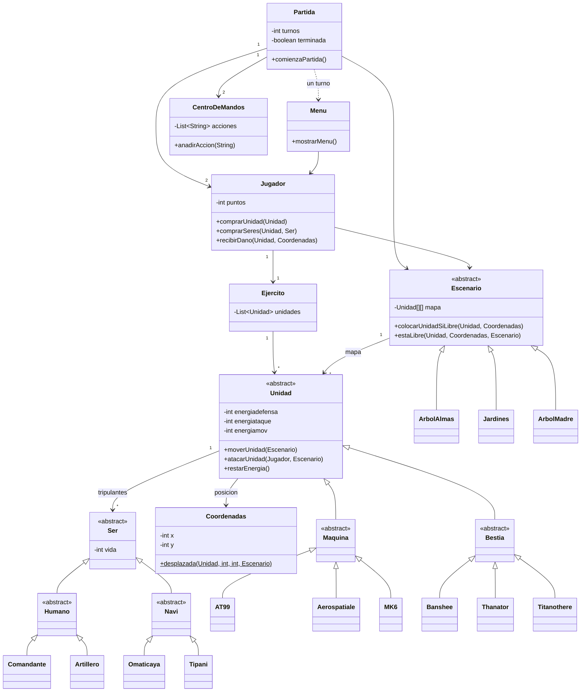

[English](README.en.md) · **Español**

# Avatar: Battle for Freedom

[](https://github.com/ArturoFierroPardo/avatar-battle-for-freedom/actions/workflows/build.yml)
[](https://openjdk.org/projects/jdk/17/)
[](LICENSE)
[](https://arturofierropardo.github.io/avatar-battle-for-freedom/)

Un juego de estrategia por turnos para dos jugadores, jugado en la consola y
ambientado en Pandora. Cada jugador manda una facción — la **RDA** humana o los
**Na'vi** —, compra unidades, las tripula, las despliega en una rejilla y lucha
hasta que uno de los dos ejércitos queda aniquilado.

Escrito en Java como práctica de la asignatura de Programación Orientada a
Objetos del grado en Ingeniería de Sistemas de Telecomunicación de la
Universidad CEU San Pablo. La entrega original se conserva en el historial del
repositorio; la versión actual añade compilación con Maven, una batería de
pruebas y los arreglos de los defectos que salieron al revisarlo.

> La interfaz del juego está en español, igual que los identificadores del código y el
> Javadoc.

---

## Contenido

- [Cómo se juega](#cómo-se-juega)
- [Unidades y tripulantes](#unidades-y-tripulantes)
- [Escenarios](#escenarios)
- [Cómo ejecutarlo](#cómo-ejecutarlo)
- [Diseño](#diseño)
- [Estructura del proyecto](#estructura-del-proyecto)
- [Pruebas](#pruebas)
- [Licencia](#licencia)

---

## Cómo se juega

Los jugadores alternan turnos. En tu turno eliges una acción del menú:

| Opción | Acción |
|---|---|
| 1 | Comprar unidades, y los tripulantes que cada una necesita para operar |
| 2 | Mover una unidad |
| 3 | Atacar a una unidad enemiga |
| 4 | Abrir tu centro de mandos |
| 5 | Pasar, acabando el turno sin hacer nada |
| 6 | Guardar la partida y salir |

Una acción por turno: comprar, mover o atacar lo da por terminado, y la opción 5
está para cuando prefieres pasar.

Todo cuesta **puntos**. Empiezas con una asignación que depende del escenario,
la gastas en unidades y tripulantes, y ganas más destruyendo unidades enemigas
y matando a sus tripulantes. Una unidad sin la tripulación completa no puede
moverse ni atacar.

El combate se resuelve primero contra la **energía de defensa** de la unidad.
Una vez agotada, el daño sobrante se reparte a partes iguales entre los
tripulantes; los que se quedan sin vida mueren, y una unidad que pierde a toda
su tripulación queda destruida y se retira del tablero. El fuego amigo es
posible, y el registro del centro de mandos lo indica cuando ocurre.

Moverse y atacar también consumen **energía de movimiento** y **energía de
ataque**, que no se regeneran: una unidad tiene una vida útil finita por mucho
daño que sea capaz de aguantar.

El **centro de mandos** es el registro privado de cada jugador: toda acción de
cualquiera de los dos bandos queda anotada con su hora, pero ves más detalle de
tus propios movimientos que de los del rival — a ti te dicen que el enemigo ha
movido una unidad, no a dónde.

Las partidas se pueden guardar y retomar; varias conviven en `partidas.dat` y se
ofrecen como lista al arrancar.

### Una sesión, abreviada

```
	AVATAR BATTLE FOR FREEDOM

-------------------ESCENARIOS-------------------

1) Arbol de las Almas:
	Nombre: Arbol de las Almas
	Puntos iniciales de cada jugador: 5000
	Dimension: 100X100
...
Jugador 1, elija su nombre:
Jugador 2, elija su nombre:

-------------------SELECCION DE EQUIPO-------------------

	1) Equipo RDA
	2) Equipo NAVI

La partida comienza en el escenario Arbol de las Almas.
Luchara Arturo del equipo NAVI contra Quaritch del equipo RDA

TURNO---------->  1
Turno de Arturo

-------------------MENU-------------------

	1) Comprar una unidad
	2) Mover una unidad
	3) Atacar a una unidad enemiga
	4) Ver el centro de mandos
	5) Finalizar el turno
	6) Finalizar y guardar partida
```

---

## Unidades y tripulantes

Cada facción tiene su propio catálogo. Las máquinas las tripulan humanos, a las
bestias las montan los Na'vi.

### RDA — máquinas

| Unidad | Coste | Defensa | Ataque | Potencia | Alcance ataque | Movimiento | Tripulantes |
|---|---|---|---|---|---|---|---|
| AT-99 Escorpion | 15000 | 7500 | 7500 | 500 | 10 | 20 | 4 |
| Aerospatiale SA-2 Samson | 2500 | 1000 | 1000 | 80 | 5 | 10 | 2 |
| Mitsubishi MK-6 | 500 | 500 | 1000 | 20 | 1 | 2 | 1 |

### Na'vi — bestias

| Unidad | Coste | Defensa | Ataque | Potencia | Alcance ataque | Movimiento | Tripulantes |
|---|---|---|---|---|---|---|---|
| Thanator | 8000 | 9000 | 9000 | 600 | 5 | 50 | 3 |
| Banshee de Montaña | 2000 | 3500 | 8000 | 300 | 10 | todo el mapa | 2 |
| Titanothere Cabezamartillo | 1000 | 11000 | 11000 | 300 | 1 | 2 | 1 |

La Banshee es la excepción: no tiene alcance de movimiento y salta a una casilla
libre cualquiera del mapa, a un coste fijo de energía. El MK-6 está en el otro extremo: es la unidad más barata del juego y la de menor
alcance, tanto de ataque como de movimiento, pero su energía de defensa le basta
para encajar un impacto de cualquier unidad sin que su piloto llegue a sufrirlo.

### Tripulantes

| Tripulante | Facción | Cargo | Coste | Vida | Puntos al derrotarlo |
|---|---|---|---|---|---|
| Comandante de SecOps | RDA | Oficial | 100 | 150 | 400 |
| Artillero | RDA | Guerrero | 50 | 150 | 100 |
| Omaticaya | Na'vi | Oficial | 100 | 300 | 400 |
| Tipani | Na'vi | Guerrero | 50 | 300 | 250 |

---

## Escenarios

| Escenario | Rejilla | Puntos iniciales |
|---|---|---|
| Árbol de las Almas | 100 × 100 | 5 000 |
| Jardines Colgantes | 200 × 200 | 20 000 |
| Árbol Madre | 300 × 300 | 45 000 |

---

## Cómo ejecutarlo

Necesitas un **JDK 17 o posterior** y Maven.

```bash
git clone https://github.com/ArturoFierroPardo/avatar-battle-for-freedom.git
cd avatar-battle-for-freedom
mvn package
java -jar target/avatar-battle-for-freedom.jar
```

Para jugar sin compilar nada, descarga el jar de la
[última release](https://github.com/ArturoFierroPardo/avatar-battle-for-freedom/releases/latest)
y ejecuta `java -jar avatar-battle-for-freedom.jar`. Solo necesita un JRE 17 o
posterior.

Dos de los mensajes del juego llevan caracteres acentuados, así que en una
consola que no esté en UTF-8 — típicamente el símbolo del sistema de Windows —
conviene ejecutar antes `chcp 65001` para que se vean bien.

Las partidas guardadas se escriben en `partidas.dat`, en el directorio de
trabajo.

En un IDE, abre la carpeta como proyecto Maven: NetBeans, IntelliJ IDEA y
Eclipse leen el `pom.xml` directamente, sin configurar nada más.

Otros comandos útiles:

```bash
mvn test              # ejecuta la batería de pruebas
mvn javadoc:javadoc   # genera el Javadoc en target/apidocs
```

---

## Diseño

El modelo es una jerarquía de herencia con dos raíces abstractas. `Unidad`
recoge todo lo que tienen en común las piezas jugables — coste, las tres
reservas de energía, potencia, alcance y tripulación — y deja que cada unidad
concreta aporte sus propios números. Las unidades que gastan energía de
movimiento a un coste fijo en lugar de por casilla sobrescriben `restarEnergia`,
y la Banshee sobrescribe `moverUnidad` por completo porque ignora el alcance de
movimiento.



---

## Estructura del proyecto

```
src/main/java/
├── main/                      punto de entrada
├── interfaz/
│   ├── partida/               bucle de turnos y condiciones de victoria
│   ├── menu/                  el menú del turno y los mercados
│   └── centrodemandos/        registro de acciones por jugador
├── modelos/
│   ├── jugador/               puntos, ejército, acciones
│   ├── ejercito/
│   ├── equipo/                RDA / NAVI
│   ├── escenario/             escenarios y el tablero
│   ├── coordenadas/           casillas, límites y desplazamiento
│   ├── unidad/                Unidad → Maquina | Bestia
│   ├── ser/                   Ser → Humano | Navi
│   └── excepciones/           violaciones de las reglas
├── io/                        guardado y carga
└── utils/                     lectura por consola

src/test/java/                 102 pruebas con JUnit 5
```

---

## Pruebas

102 pruebas con JUnit 5. Cubren la lógica de dominio — límites del tablero,
escenarios, unidades, tripulantes, el ejército, las acciones del jugador y la
persistencia — y también el bucle de turnos y el menú, que se ejercitan con
partidas guionizadas inyectadas por `Utils.usarEntrada`, capturando la salida
por consola para comprobar lo que ve el jugador.

```bash
mvn test
```

Son pruebas de regresión tanto como pruebas unitarias: cada defecto corregido
tiene una prueba que lo fija, con un comentario que explica qué fallaba antes. La batería se comprobó por mutación — al reintroducir a mano los bugs
originales que arreglan, falla; al deshacerlo, vuelve a pasar entera.

---

## Licencia

[MIT](LICENSE) © Arturo Fierro Pardo

Avatar y su universo son propiedad de 20th Century Studios. Esto es un proyecto
de estudiante, sin ánimo de lucro y sin ninguna vinculación con los titulares de
los derechos; la licencia cubre únicamente el código fuente.
